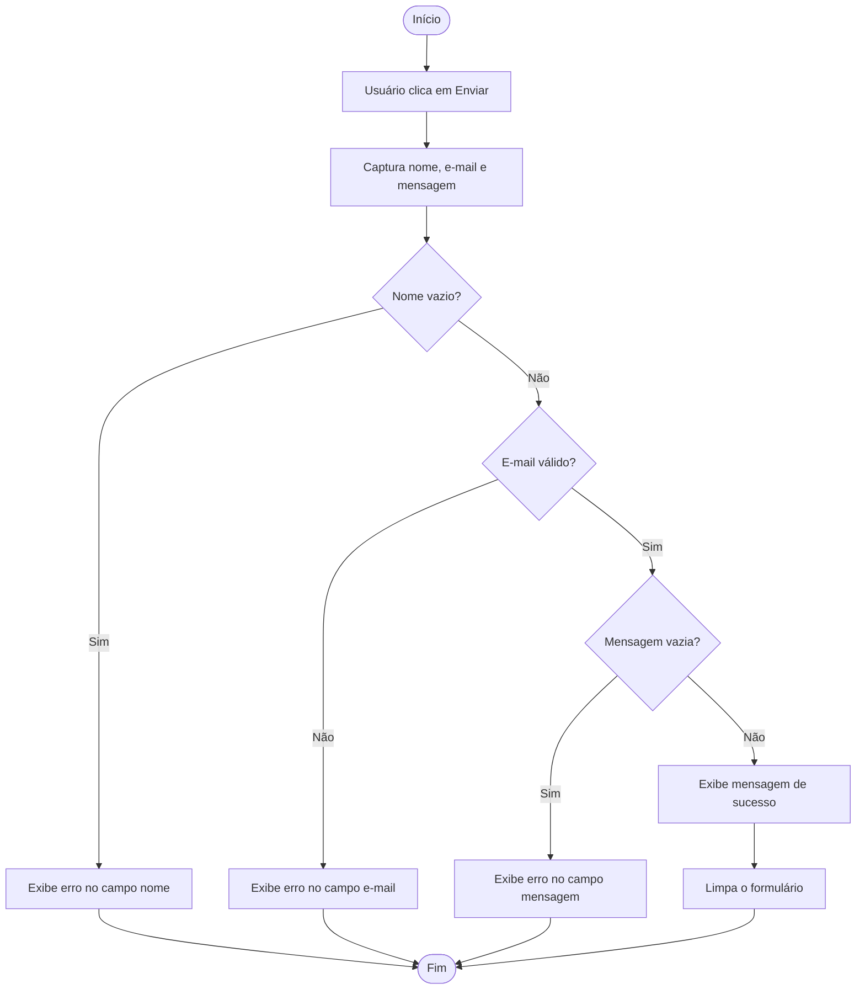
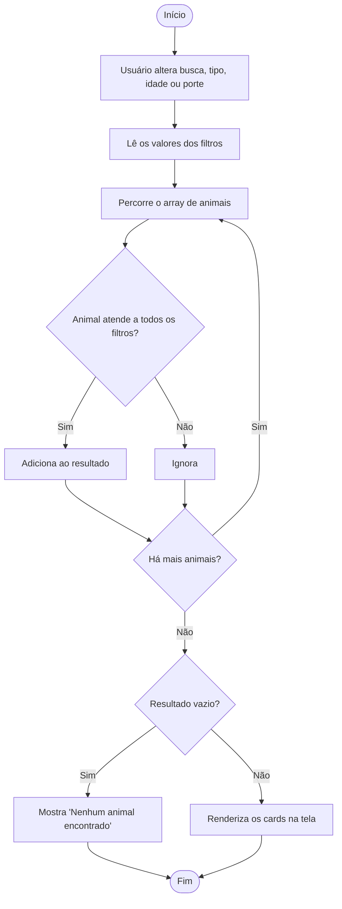

# Modelagem da Lógica – Adoção Lins

## 1. Regra de negócio: validação do formulário de contato

## 2. Filtro da listagem de animais

## 3. Tipos de dados, variáveis e estruturas

| Elemento | Tipo | Exemplo |
|---|---|---|
| Lista de animais | Array de objetos | `const animais = [...]` |
| Animal | Objeto | `{ nome: "Mel", tipo: "Cachorro", idade: 3, porte: "Médio", foto: "mel.webp" }` |
| Nome, e-mail, mensagem | String | `"contato@email.com"` |
| Idade | Number | `3` |
| Filtros ativos | Objeto | `{ busca: "", tipo: "todos", idade: "todas", porte: "todos" }` |
| Formulário válido | Boolean | `true` / `false` |

**Estruturas condicionais:** `if/else` na validação de cada campo e na decisão de exibir "nenhum resultado".

**Estruturas de repetição:** `for...of` / `forEach` / `filter` para percorrer o array de animais e gerar os cards.

**Funções previstas:** `validarFormulario()`, `emailValido(email)`, `filtrarAnimais(animais, filtros)`, `renderizarCards(lista)`, `mostrarErro(campo, mensagem)`.
